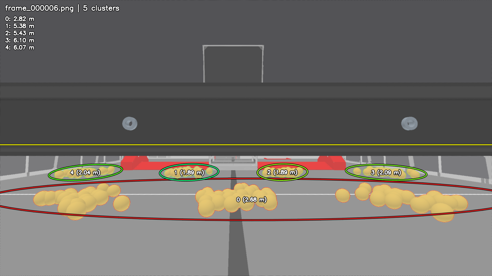
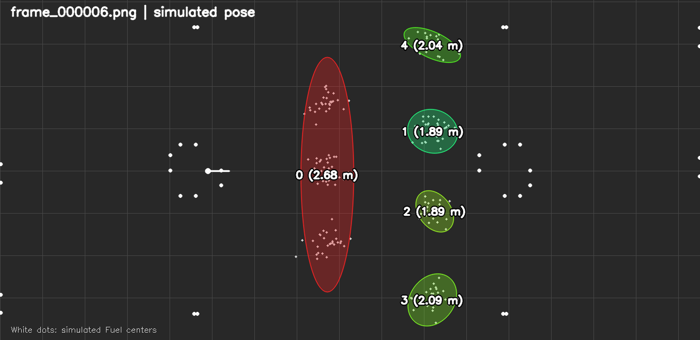

Seven distinct visible piles: regression found
============================================

Tested the deployed C++ implementation at 7871743 on root@dev-orin, using only
simulated RGB. No tracker parameters or acceptance thresholds were changed.
There are seven Gaussian piles, 203 generated balls, four seeds (7, 23, 41,
59), and thirteen translating/rotating camera poses per seed. The closest pile
centers are 1.7 m apart. All seven groups have at least fourteen visible balls in
every frame, confirmed independently by the simulator's ID/depth render.
`--expected-clusters 7` now explicitly checks that reference visibility condition.

| Seed | Frames | Truth / predicted count | Missed groups | ID switches | Worst centroid / shape error (m) |
|---|---:|---|---:|---:|---|
| 7 | 13 | 7 / 5 throughout | 26 | 0 | 0.2240 / 1.2018 |
| 23 | 13 | 7 / 7 throughout | 0 | 0 | 0.1286 / 0.1757 |
| 41 | 13 | 7 / 6 throughout | 13 | 0 | 0.7869 / 0.6397 |
| 59 | 13 | 7 / 7 throughout | 0 | 0 | 0.1492 / 0.1516 |

Result: FAIL. Only 26/52 frames have the correct count. There are 39 missed
group observations, no extra groups, and no ID switches among matched groups.
Centroid/shape numbers cover matched predictions; missing groups also fail the
count gate. The original 0.35 m centroid and 0.30 m covariance Bures-distance
limits remain in force. Noise was not added because the ideal suite fails.

The seed-7 image shows three separate foreground piles covered by one ellipse;
the seed-41 image merges two foreground piles. Thus the density/watershed
grouping is too permissive for these layouts. This is a clustering failure,
not a shortage of reference visibility. No algorithm fix is included in this
validation change. Earlier results with at most three piles do not establish
reliable behavior for seven piles.




Direct C++ replay of the failing seed-7 run, already present on dev-orin:

```sh
ssh root@dev-orin
cd /root
./tools/hsv_cluster_visualizer \
  --sim_run=/root/cluster-validation/seven-full-ideal/seven-7 \
  --output_dir=/root/cluster-validation/seven-replay
```

Generate that scene again using C++ binaries (poses are copied from
`validation/seven_poses.json`):

```sh
./tools/path_camera_sim \
  --poses=/root/cluster-validation/seven_poses.json \
  --camera_config=constants/gamepiece/camera.json \
  --fuel_truth --fuel_seed=7 --fuel_noise=0 \
  --fuel_clusters='[{"center_m":[7.7,2.3],"density":100,"covariance_m2":[0.055,0.035],"rotation_rad":0.3},{"center_m":[7.7,4],"density":100,"covariance_m2":[0.065,0.035],"rotation_rad":-0.5},{"center_m":[7.7,5.7],"density":100,"covariance_m2":[0.05,0.04],"rotation_rad":0.8},{"center_m":[10.2,1],"density":100,"covariance_m2":[0.065,0.04],"rotation_rad":0.7},{"center_m":[10.2,3],"density":100,"covariance_m2":[0.055,0.035],"rotation_rad":-0.6},{"center_m":[10.2,5],"density":100,"covariance_m2":[0.06,0.04],"rotation_rad":0.4},{"center_m":[10.2,7],"density":100,"covariance_m2":[0.05,0.035],"rotation_rad":-0.2}]' \
  --output_dir=/root/cluster-validation/seven-regenerated
./tools/hsv_cluster_visualizer \
  --sim_run=/root/cluster-validation/seven-regenerated \
  --output_dir=/root/cluster-validation/seven-regenerated/clusters
```

Reproduce all four seeds, from /root on dev-orin:

```sh
python3 cluster-validation/run_gamepiece_validation.py \
  --root /root/cluster-validation/seven-full-ideal \
  --scenarios /root/cluster-validation/seven_scenarios.json \
  --poses /root/cluster-validation/seven_poses.json --seeds 7,23,41,59
```

Download manifests and cluster JSON locally, then evaluate (exit status 1 is
the recorded failure):

```sh
rsync -r --include='*/' --include='manifest.json' --include='clusters.json' \
  --exclude='*' root@dev-orin:/root/cluster-validation/seven-full-ideal/ \
  /tmp/gamepiece-seven-full-ideal/
python3 scripts/evaluate_gamepiece_validation.py /tmp/gamepiece-seven-full-ideal \
  --expected-clusters 7 --output validation/evidence/seven-ideal.json
```

Two earlier camera-placement diagnostics are also retained, rather than
discarding their failures. `seven-ideal` on the target uses
`seven_edge_scenarios.json` and `seven_clipped_poses.json`: seed 23 misses an
edge pile in five frames (7 reference groups throughout); seed 7 passes.
`seven-visible-ideal` uses the same edge scenarios and
`seven_obstructed_poses.json`: backing the camera up put it inside a field
structure, leaving only 4–6 reference groups visible and causing further count
and geometry failures. These are not included in the 52-frame seven-visible
result. Their measurements are in `evidence/seven-clipped-edge.json` and
`evidence/seven-obstructed.json`; full images/manifests remain on dev-orin.

Required build and deployment both succeeded:
`cmake --build build --parallel 6` and
`cmake --build build --target dev-orin`. Only validation scripts, fixtures,
images, and reports changed; the C++ implementation remains at 7871743.
