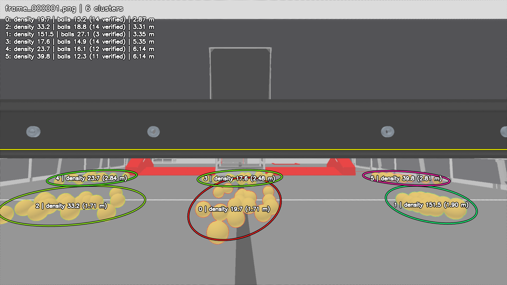
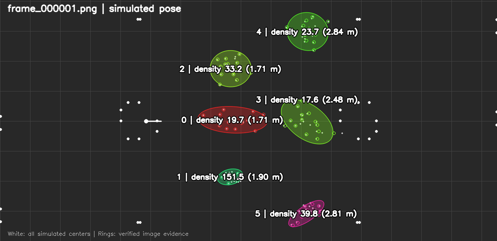

# Ball density approximation

The canonical output is `cluster.density`, also serialized as `density` in
`clusters.json` and printed on camera/field views. Each pile produces one scalar:

```
density = estimated_ball_count / density_area_m2
```

`estimated_ball_count` combines verified individual spheres with a nonnegative,
zero-intercept predictor of unexplained yellow area and unexplained internal
edges. A ball can contribute through partial image evidence. Zero-evidence
balls are excluded from calibration and validation targets.

The footprint is `2*pi*sqrt(det(C + r*r/4*I))`, with radius `r = 0.075 m`.
`C` blends verified-ball position covariance with the existing pile covariance
(three prior observations); sparse detections retain the existing covariance.
This is a Gaussian effective area, so the scalar is an approximate relative
concentration rather than a calibrated average over a bounded region. Doubling
the estimated ball count doubles density; doubling both footprint axes divides
it by four.

## Image evidence and calibration

The counter uses calibrated sphere-tangent votes from grayscale edges, including
edges inside the yellow mask. Candidates are checked against projected sphere
outlines and gradient directions, and each accepted sphere must explain new
image edges. Small apparent balls are resized before voting to preserve partial
arcs at different distances. Verified positions are published in robot meters.

After rendering the verified silhouettes, the remaining area and edge evidence
is measured in full-sphere area/perimeter equivalents. The predictor is:

```
count = verified_count + 4.632368 * residual_area + 2.421001 * residual_edges
```

Both correction terms disappear when their image evidence disappears. The two
weights were fit to relative count error using nonnegative least squares, with
no intercept. [Calibration](calibration.json) records the coefficients, source
hashes, and training error. Reproduce the fit with:

```sh
python3 scripts/calibrate_gamepiece_density.py \
  validation/density/training-development.json \
  validation/density/training-extended.json \
  --output /tmp/density-calibration.json
```

Training uses 256 ideal frames from seeds 7, 23, 41, 59, 101, 202, 313, and 419.
The 13 frames with a pre-existing pile split remain in the reports and are
excluded from fitting an ambiguous count-to-pile assignment. The fit uses 1,458
unambiguous pile observations. Tracker separation, location, shape, and ID logic
are unchanged by this work.

## Validation

The reference is every generated ball with at least one
independently rendered ID-visible pixel, including partially visible balls.
The simulator labels, memberships, and visibility counts never enter the tracker.
Seeds 1009, 2003, 3001, and 4001 were excluded from calibration; fixtures cover six simultaneous
piles, increasing count at fixed size, equal density at different sizes, equal
count at different sizes, denser piles, and wider piles. Five camera positions
span field X = 4.60–5.60 m.

Density comparisons use within-frame ratios and symmetric multiplicative error;
a factor of 1 is exact. Verified-position precision uses independent one-to-one
matching within 15 cm and, separately, within one ball radius (7.5 cm). Every
geometry/count mismatch remains in the reports.
The `visible_fuel_support` diagnostic retains the previous silhouette-support
measurement; image heatmaps visualize those projected silhouette samples.

The comparison replays the frozen baseline (`83c5009`) and this implementation
on identical RGB. Each condition has 20 runs, 100 frames, 600 matched pile
observations, and 1,500 within-frame pile pairs. Positional noise is 0.1 m.
The baseline density is `peak_density_per_m2`; its count proxy is silhouette
support. The new columns use `density` and `estimated_ball_count`.

| Metric | Baseline ideal | New ideal | Baseline noisy | New noisy |
|---|---:|---:|---:|---:|
| Median absolute count error | 59.4% | **16.0%** | 56.4% | **15.6%** |
| Median density-ratio error factor | 1.85 | **1.43** | 1.88 | **1.42** |
| 90th percentile ratio error factor | 4.36 | **2.35** | 4.17 | **2.48** |
| Correct ordering for reference contrast >=2x (468 pairs) | 49.4% | **85.0%** | 56.2% | **85.5%** |

Verified detections have 99.1% / 99.0% precision within 15 cm and
96.3% / 96.5% within 7.5 cm (ideal / noisy). Their recall is only
53.8% / 57.1%: individual detections alone would miss substantial visible
evidence. The residual predictor supplies the rest. New count error at the
90th percentile is 40.0% / 39.9%.

Median tracker processing time on dev-orin is **130.1 / 139.4 ms**, with
95th percentile **160.3 / 168.2 ms**, excluding image loading and drawing.
These are coarse relative-density estimates, with imperfect ordering and
substantial tail errors; they do not establish exact counts or real-camera
accuracy. This simulator-only calibration needs real-camera validation.

Five ideal and nine noisy frames retain a pre-existing split (seven tracker
outputs for six reference piles). They remain in the density results; extra
outputs are separately reported rather than assigned fabricated reference
densities. [Geometry regression](geometry-regression.json) confirms every
pre-existing geometry, ID, and support field is exactly equal to baseline in
all 200 frames. This change does not fix those splits.

Full measurements: [ideal](ideal-validation.json), [noisy](noisy-validation.json),
[baseline ideal](baseline-ideal.json), [baseline noisy](baseline-noisy.json),
and [audit](audit.json). All **29 C++ tests passed** on dev-orin:
[log](target-tests.txt), [tracker XML](unit-results.xml). The controlled 9/25-ball
test also checks footprint and camera-distance response. The exact calibration
can be regenerated from the two training reports using the command above.

## Representative output

The images below are noisy `six_equal_count-1009`, frame 1: all six piles have
20 image-visible balls, but different footprints. This frame was selected by
the median pair-ratio error closest to the median of the 20 noisy equal-count
frames (factor 1.300 versus cohort median 1.293), rather than the best result.
Its counts still range from 12.3 to 27.1, showing the remaining errors.




White field dots are all generated centers; colored rings are verified image
evidence. The scalar includes the residual predictor, so its count can exceed
the number of rings. Field ellipses show the unchanged tracker geometry;
`density_area_m2` additionally incorporates verified-ball spread.

## Run the C++ implementation

From `/root/cos-worktrees/gamepiece-ball-density`:

```sh
cmake --build build --parallel 6
cmake --build build --target dev-orin
ssh root@dev-orin
cd /root
./tools/hsv_cluster_visualizer \
  --sim_run=/root/cluster-validation/ball-density/accepted-density/noisy/six_equal_count-1009 \
  --output_dir=/root/cluster-validation/density-review
```

Inspect `frame_000001_clusters.png`, `frame_000001_field.png`, and
`clusters.json`. A copy of the validated visualizer is retained at
`/root/cluster-validation/ball-density/accepted-density/tools/hsv_cluster_visualizer`.
The complete original outputs remain under `accepted-density/{ideal,noisy}`;
the same-input baseline outputs are under `baseline-{ideal,noisy}`.

To regenerate the validation matrix on dev-orin, copy the runner and fixtures
there, then run from `/root` (use `--noise=0` and a distinct root for ideal):

```sh
python3 /root/cluster-validation/ball-density/accepted-density/review/scripts/run_gamepiece_validation.py \
  --root=/root/cluster-validation/ball-density/reproduced-noisy \
  --scenarios=/root/cluster-validation/ball-density/accepted-density/review/holdout_scenarios.json \
  --poses=/root/cluster-validation/ball-density/accepted-density/review/holdout_poses.json \
  --seeds=1009,2003,3001,4001 --noise=0.1
```

Download metadata and evaluate locally (Python requires NumPy and SciPy):

```sh
rsync -r --include='*/' --include='manifest.json' --include='clusters.json' \
  --exclude='*' root@dev-orin:/root/cluster-validation/ball-density/accepted-density/noisy/ \
  /tmp/ball-density-noisy/
python3 scripts/evaluate_gamepiece_density.py /tmp/ball-density-noisy \
  --output=/tmp/density-noisy-results.json
```

The calibration assumes the configured ball radius, HSV appearance, camera
calibration, and ground plane. Count and footprint estimates remain approximate,
particularly for tiny fragments and strongly overlapping balls. Runtime and
remaining proportionality errors are quantified in the final reports.
